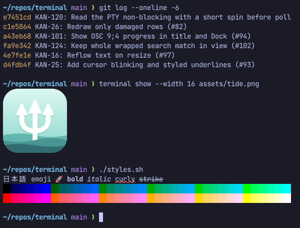

<p align="center">
  
</p>

<h1 align="center">Trident</h1>

<p align="center">A fast, GPU-rendered terminal emulator for macOS and Linux, written from scratch in Rust.</p>

<p align="center">
  
</p>

## Install

Download a build from [Releases](https://github.com/amagomori/terminal/releases):

- **macOS** (11 or newer, Apple silicon and Intel): `Trident-<version>-macos-universal.dmg`; drag
  Trident to Applications. Builds are unsigned, so macOS reports a downloaded .dmg as "damaged";
  run `xattr -d com.apple.quarantine ~/Downloads/Trident-<version>-macos-universal.dmg` before
  opening it. An app already copied from a quarantined image needs
  `xattr -dr com.apple.quarantine /Applications/Trident.app`.
- **Debian/Ubuntu**: `sudo apt install ./Trident-<version>-linux-amd64.deb`; installing a newer
  .deb the same way upgrades it.
- **Any Linux** (glibc 2.35 or newer): `chmod +x Trident-<version>-x86_64.AppImage` and run it, or
  unpack the tarball into `~/.local`:
  `tar xzf Trident-<version>-linux-x86_64.tar.gz -C ~/.local --strip-components=1`.
  The app menu entry runs `trident` from your login `PATH`, so log out and back in if `~/.local/bin`
  was not there before.

`SHA256SUMS` lists every file's checksum (`sha256sum -c SHA256SUMS`).

### From source

You need a [Rust toolchain](https://rustup.rs) (1.90 or newer).

```sh
git clone https://github.com/amagomori/terminal
cd terminal
cargo run --release
```

Or install the `trident` binary into `~/.cargo/bin`:

```sh
cargo install --path crates/term-app
```

No system libraries are needed beyond a graphics driver (on Linux: Mesa or a vendor Vulkan/GL
driver, and an X11 or Wayland session).

## Quick start

```sh
trident                        # your login shell
trident -e htop                # run a command instead
trident show photo.png         # view an image or file inline
trident --install-terminfo     # optional: install the xterm-trident terminfo entry
```

## Features

- **GPU rendering** with [wgpu](https://wgpu.rs) (Metal, Vulkan or OpenGL); idle, it uses no CPU or GPU.
- **xterm-compatible**: truecolor, mouse reporting, alternate screen, wide characters; runs vim, tmux and htop.
- **Scrollback search**, rectangular selection, and shell integration (OSC 133) with prompt jumps.
- **Inline images** (kitty graphics protocol), desktop notifications, and file drops.
- **Color emoji and font fallback**, with JetBrains Mono bundled.
- **Live-reloaded config** with bundled themes that can follow the OS appearance.

## Configuration

Settings live in `~/.config/trident/config.toml` (or `$XDG_CONFIG_HOME/trident/config.toml`),
and every entry is optional. See [docs/configuration.md](docs/configuration.md).

## Documentation

- [Usage](docs/usage.md): command line, terminfo, shortcuts, search, selection, pasting, notifications
- [Configuration](docs/configuration.md): settings, key bindings, shell integration, themes
- [Development](docs/development.md): crate layout, tests, latency and comparison harnesses
- [Full feature list](docs/README.md#features)

## License

MIT. The bundled JetBrains Mono fonts are under the SIL Open Font License 1.1
(`crates/term-render/assets/fonts/OFL.txt`).
